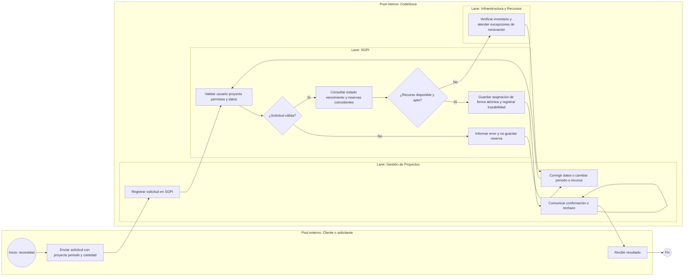

# Proceso BPMN: asignación de recursos técnicos

**Pool cliente:** solicitante del proyecto (fuera del control interno). **Pool CodeNova:** lanes Gestión de Proyectos, SGPI e Infraestructura y Recursos. El diagrama muestra la solicitud, validación, decisión por disponibilidad y confirmación. La reserva se persiste antes de confirmar.

## Reglas y excepciones

- La persona solicitante debe estar activa y autorizada; proyecto y recurso deben existir.
- No se asignan equipos en mantenimiento o baja. En licencias con vencimiento, la vigencia debe cubrir todo el período.
- La suma de asignaciones coincidentes no supera `capacidad_uso`. La verificación y escritura se realizan como una operación atómica para prevenir reservas simultáneas incompatibles.
- Si los datos son inválidos, se informa el motivo y Gestión corrige la solicitud. Si no hay disponibilidad, puede cambiar período o recurso y revalidar.
- Una licencia vencida se deriva a Infraestructura para renovación por su circuito; la solicitud se vuelve a validar después.
- Solo se confirma luego de guardar. Si falla el guardado, no se envía confirmación.

**Nota:** diagrama de diseño para el caso académico; no describe un proceso productivo ya implementado.
